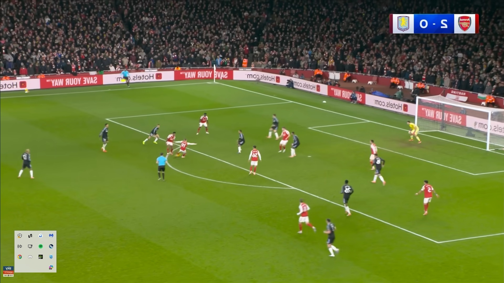
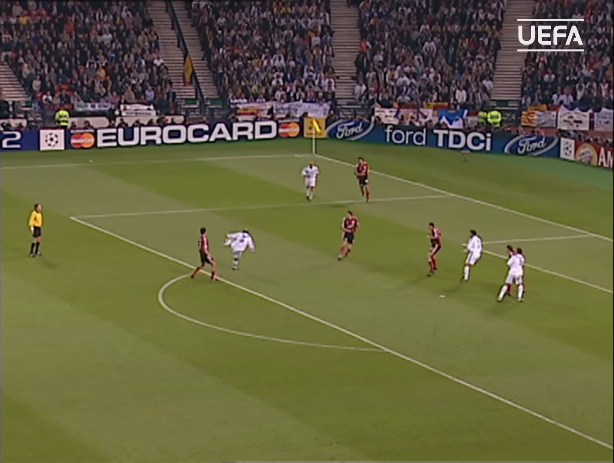

# GoalGuessr shot extraction

A semi-automatic MATLAB tool that turns a broadcast frame of a football shot into real pitch coordinates (metres). I built it to create the location data for [GoalGuessr](https://goalguessr.net), a football shot-location guessing game.

## How it works

1. You click known pitch landmarks in the frame (penalty spot, box corners, six-yard box, goal posts and so on). At least 4 are needed and up to 15 can be used.
2. The script fits a projective transform (homography) from image pixels to a 105 x 68 m pitch using MATLAB's `fitgeotrans`.
3. You click the ball (or strike point) and the script converts it to pitch coordinates.
4. The batch script repeats this for every image in a folder and logs the results to a tab-separated file.

This is human-in-the-loop calibration, not automatic detection and not a trained model.

## Requirements

- MATLAB (version used: R2024a) with the Image Processing Toolbox
- Your own images, named `goal001.jpg`, `goal002.jpg` and so on, in a folder called `Images_for_MATLAB` next to the scripts. Only two low-resolution example frames are included in this repository (see below).

## Usage

Single image:

```matlab
[shotXY, name, tform] = goal_to_pitch_coords("goal001.jpg");
```

Whole folder:

```matlab
batch_extract_shot_coords
```

Results are appended to `shot_coordinates.txt`. Images already listed in that file are skipped, so you can stop and resume at any time. Choose STOP in the landmark dialog to quit cleanly.

## Output format

Illustrative values:

```
filename        x        y
goal001.jpg     94.215   31.440
goal002.jpg     88.730   40.105
```

`x` runs along the pitch (0 to 105, with the goal at x = 105) and `y` runs across it (0 to 68).

## Assumptions and limitations

- All images are assumed to be attacking right. Flip them manually if not.
- The transform assumes the clicked point is on the pitch surface, so a ball in the air adds error.
- Accuracy depends on click precision and on how many landmarks are visible. Zoomed or distorted broadcast frames are less reliable.

## Example frames

These two low-resolution frames are from broadcast footage and are included for illustration only. The footage belongs to its respective rights holders. If you are a rights holder and would like an image removed, please contact me through my GitHub profile and I will remove it promptly.




The MIT licence in this repository covers the code only, not these images.